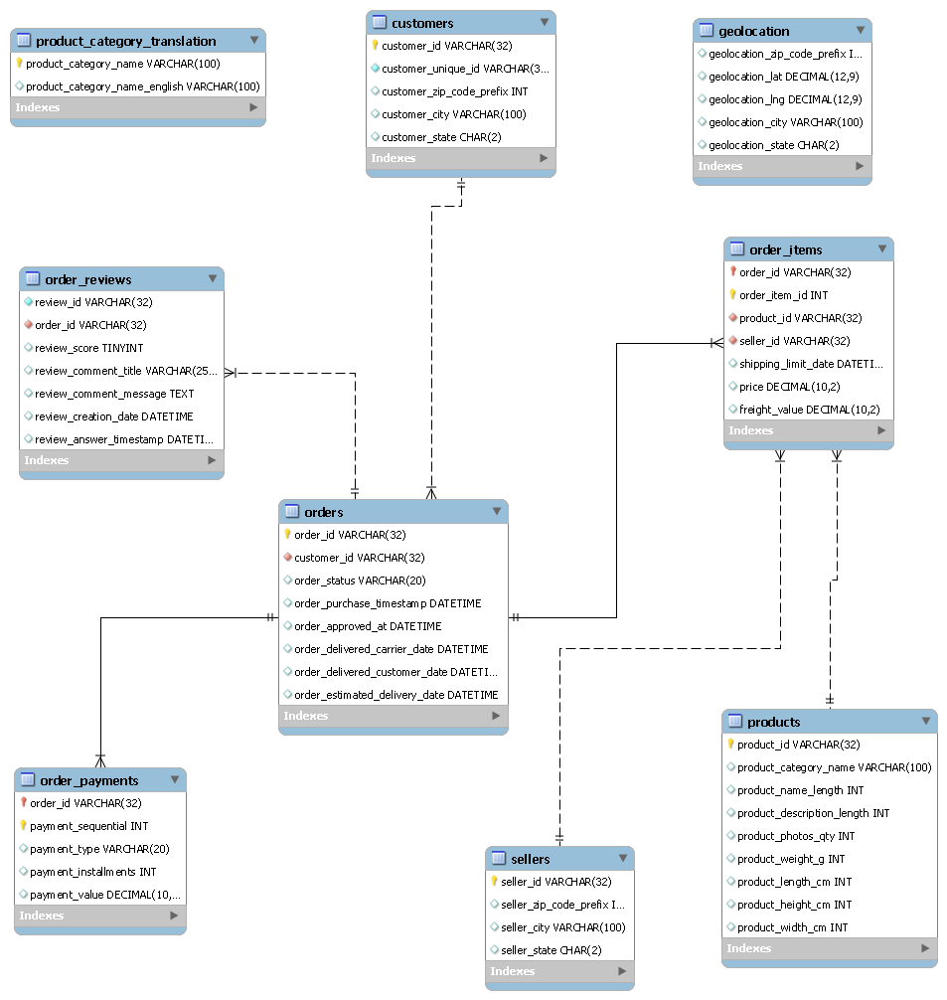

# Olist Customer Retention & Delivery Performance Analytics

<!-- CHANGE: This summary is a draft. Revise it once the model and dashboard are finished. -->
About 97% of Olist customers buy only once. I used SQL, Python and Excel to test why they don't return.
Late delivery cuts review scores sharply (4.29 vs 2.57 stars) but only slightly lowers repeat buying
(3.07% vs 2.53%), review score does not separate repeat buyers, and the first-purchase category matters most
but with a small effect. Two prediction models reach a ROC-AUC of only about 0.53, so first-order data barely
predicts who returns. Repeat buyers are only 3.04% of customers, and one cooling segment ("At risk") holds
26.52% of spend, which makes it the best group for a win-back test.

> **Status:** Phases 0 to 4 complete: database built and profiled, 19 business queries, an Excel summary,
> a cleaning and EDA notebook, a retention notebook (cohorts, RFM segments, significance tests), SQL window
> functions, and a modelling notebook (two models, category test, answer to the business question).
> The Power BI dashboard and the one-page business summary are next.

## Business Problem
Olist is a Brazilian e-commerce marketplace where almost all customers buy only once
(confirmed on the data: about 97%, see Key Findings).
This project investigates why customers don't return and what the business can do about it.

**Key questions**
1. Who are the repeat buyers, and how do they differ from one-time buyers?
2. How does delivery performance affect review scores and repeat purchases?
3. Which customer segments and regions offer the biggest retention opportunity?
<!-- CHANGE: edit or add questions as your analysis evolves -->

## Data Source

[Brazilian E-Commerce Public Dataset by Olist](https://www.kaggle.com/datasets/olistbr/brazilian-ecommerce) (Kaggle).

- 99,441 orders from September 2016 to October 2018, across 9 relational CSV files
- The CSVs are not stored in this repo. To reproduce the project, download the dataset
  from Kaggle and extract the files into `data/raw/`
- Raw files are never edited; cleaned outputs go to `data/processed/`

## Database Design



Nine tables in MySQL. Six foreign keys link orders to customers, order items to orders,
products and sellers, and payments and reviews to orders. Before adding the keys, I checked
all six relationships for orphan rows (rows pointing to a parent that does not exist) and
found none. `geolocation` and `product_category_translation` are lookup tables without
foreign keys.

## Key Findings (so far)
Figures come from `sql/04_data_profiling.sql`, `sql/05_business_questions.sql` and the notebooks.
The delivery and review-score comparisons are significance-tested in `notebooks/02_retention_rfm.ipynb`
and `notebooks/03_modeling.ipynb` (Mann-Whitney and chi-square tests, with effect sizes). The state and cohort
differences are not tested. Everything here is an association from one dataset, not proof of cause.

**Retention**
- **About 97% of customers buy only once.** Excluding canceled and unavailable orders,
  92,102 of 94,990 customers (96.96%) placed exactly one order. Customers are counted with
  `customer_unique_id`, because `customer_id` is created per order (99,441 values vs 96,096 people).
- **There is no second wave of returns.** In the monthly cohort heatmap (2017-01 to 2018-08), no month after
  the first goes above 0.71% of a cohort. 39.6% of repeat orders (1,273 of 3,217) happen in the same
  calendar month as the first order.
- **Late delivery explains only a small part.** Customers whose first order arrived late returned
  2.53% of the time against 3.07% for on time (chi-square p = 0.0088; 7,595 vs 85,698 customers).
  With at least 6 months to return the gap is similar (3.22% vs 4.09%, p = 0.0063), so limited time to
  return does not explain it. Even among on-time customers, about 96% never came back.
- **A bad first review does not explain it.** The repeat rate is 2.69% to 3.15% across all five scores
  (chi-square p = 0.082, Cramer's V = 0.0095, essentially no effect). 1-star customers return about as often
  as 5-star customers.
- **What customers buy first matters most, but the effect is small.** The repeat rate by first-item category
  ranges from 1.65% (electronics) to 5.91% (fashion_bags_accessories), a wider spread than for delivery
  (0.54 points), review score (0.46) or state (1.75). A chi-square test across 21 categories (84,144 customers)
  gives p < 0.001 and Cramer's V = 0.058. Fashion bags return about twice as often as the rest (5.91% vs 2.98%),
  but that rests on 102 repeat buyers.
- **The biggest earners are not the best at retention.** health_beauty (9.2% of revenue) and
  watches_gifts (8.2%) return below the 3.04% average; bed_bath_table and furniture_decor return above it.

**Customer segments (RFM)**
- Six segments built with my own rules (recency and spend in quintiles, frequency in bands 1, 2, 3+).
- **Repeat buyers are too few to carry revenue:** Champions and Loyal are 3.04% of people and 5.66% of spend.
- **"At risk" is the best opportunity:** 14,146 people (14.89%) hold 26.52% of spend (one order, higher spend,
  about 9 months since purchase). "About to lose" is the reverse: 23.85% of people but 10.44% of spend.
- Past spend does not show that someone will return, so this needs an experiment with a control group.

**Prediction model**
- Target: did a customer order again, using only first-order information, for the 55,227 customers whose first order
  was between 2017-01 and 2018-02 (at least 6 months to return). 4.02% (2,220) are repeat buyers.
- Logistic regression reaches a ROC-AUC of 0.539 and a random forest 0.533 (0.5 is random guessing), on an 80/20
  stratified split. For the repeat class, precision is 0.044 against a base rate of 4.02%.
- Accuracy is misleading here: always predicting "no repeat" scores 95.98%.
- Permutation importance shows no feature that clearly drives the prediction.
- **First-order data barely predicts who returns**, so a scoring model built on these features would not help target
  customers.

**Delivery and satisfaction**
- Orders arrive in 12.5 days on average against 24.4 days promised; 8.1% arrive late.
- Review scores fall as orders get later: 4.29 on time and 2.57 late (Mann-Whitney p < 0.001; a random
  on-time order scores higher than a random late one 77.7% of the time). By lateness band: 3.59 up to
  3 days late, 2.10 for 4 to 7 days, 1.70 for over 7 days.
- Late share by state (all delivered orders) is highest in AL (23.9%), MA (19.7%) and PI (16.0%); SP is 5.9%.
  Among 17 states with 500+ first-order customers: MA 19.66%, CE 15.51%, BA 14.06% and RJ 13.46% late, against
  SP 5.92%. RJ combines a high late share with a high repeat rate (3.32%), so delivery does not explain
  every state difference.
- The typical delivered order arrives in 10 days (median); the mean is 12.5 because of a long
  tail of slow orders (298 orders took more than 60 days).
- 59.2% of delivered orders get 5 stars and 78.9% get 4 or 5; 1 star (9.8%) is about three times
  as common as 2 stars (3.0%).

**Revenue**
- Revenue (price + freight, delivered orders) is 15,419,773.75 across 96,478 orders;
  average order value is 159.83. Revenue from payments differs by only 0.017%.
- Monthly revenue grew through 2017 (peak 1,153,364.20 in November 2017) and was flat in 2018.
- The top 10 categories bring 62.4% of revenue; SP, RJ and MG bring 62.5%.
- Credit card is 78.5% of payments and boleto 18.0%.

**Data quality**
- Volume is only reliable from January 2017 to August 2018 (2016 is nearly empty,
  November 2016 is missing, and September and October 2018 have 16 and 4 orders).
- 547 orders have more than one review, and some review IDs are shared across orders.
  Reviews are reduced to one per order (the latest) before any join.
- 6 canceled orders have a delivery date, so lateness is only used on delivered orders.

**SQL window functions** (`sql/06_window_functions.sql`)
- ROW_NUMBER reproduces 94,990 first orders and 3,217 repeat orders; LAG shows an average of 78.9 days between a
  person's consecutive orders (930 on the same date, 696 within 1 to 30 days, 1,591 after more than 30 days; same-date
  orders may be split baskets, not checked); a running total of monthly revenue reaches 15,419,773.75 by 2018-08.

_The dashboard will be added in the next phase._

## Dashboard Preview
<!-- CHANGE: Add screenshots after Phase 5, e.g.  -->
_Coming soon._

## Tools & Technologies
<!-- CHANGE: Keep this list accurate. Add or remove anything you actually use. -->
| Purpose | Tool |
|---|---|
| Database | MySQL 8.0 (developed on 8.0.43) |
| SQL client | VS Code "Database Client" extension; MySQL Workbench for the ER diagram |
| Programming | Python 3.x (pandas, NumPy, matplotlib, seaborn, scikit-learn, SciPy, SQLAlchemy, PyMySQL, python-dotenv) |
| Notebooks / editor | VS Code with Jupyter |
| Dashboard | Power BI Desktop |
| Quick analysis | Microsoft Excel |
| Version control | Git, GitHub |
| AI assistants | Claude and ChatGPT, used for guidance, debugging and code review; all code was run and verified by me |

## Setup

**Requirements:** Python 3.10+ (Anaconda), MySQL 8.0+, Git. Built on Windows with PowerShell and VS Code.

1. Clone this repo and open it in VS Code.
2. Download the dataset from Kaggle (see "Data Source") into `data/raw/`.
3. Install the Python libraries listed under Tools & Technologies
   (a `requirements.txt` will be added in Phase 6).
4. Create the database in MySQL:
```sql
   CREATE DATABASE IF NOT EXISTS olist
     CHARACTER SET utf8mb4
     COLLATE utf8mb4_0900_ai_ci;
```
5. Copy `.env.example` to `.env` and fill in your own MySQL details
   (`DB_USER`, `DB_PASSWORD`, `DB_HOST`, `DB_NAME`). `.env` is git-ignored and never committed.
6. Test the connection:
```powershell
   python scripts\test_connection.py
```

## How to Run
<!-- CHANGE: Update as scripts and notebooks are added. -->
1. Complete the Setup section above.
2. Run `sql/01_create_tables.sql`, then load the CSVs: `python scripts\load_data.py`.
3. Run `sql/02_orphan_checks.sql` and `sql/03_add_foreign_keys.sql`.
4. Run `sql/04_data_profiling.sql` and `sql/05_business_questions.sql`
   (each query has an INSIGHT comment with its result).
5. Optional: `python scripts\export_for_excel.py` recreates the four CSVs in `data/processed/`
   that feed the Excel workbook.
6. Run `notebooks/01_cleaning_eda.ipynb` (needs the database loaded and your `.env`); it rebuilds
   `data/processed/orders_enriched.csv`.
7. Run `notebooks/02_retention_rfm.ipynb` (reads `orders_enriched.csv`; no database connection needed).
8. Run `sql/06_window_functions.sql` (three window-function queries; keep `USE olist;` at the top).
9. Run `notebooks/03_modeling.ipynb` (reads `orders_enriched.csv`; the category test uses the output of Query 19 in
   `sql/05_business_questions.sql`, pasted into the notebook).
10. Further files will be added in numbered order.

Note: `load_data.py` is meant for the first load, before the foreign keys exist.

## Project Structure
```
olist-retention-analytics/
├── data/
│   ├── raw/            # original Kaggle CSVs (not tracked)
│   └── processed/      # cleaned data (not tracked)
├── sql/                # commented SQL queries only (numbered 01_, 02_, ...)
├── scripts/            # runnable Python scripts (connection test, data loading, Excel export)
├── notebooks/          # 01 cleaning and EDA, 02 retention, RFM and tests, 03 modelling
├── dashboard/          # Power BI file
├── reports/            # Excel summary workbook (business summary to come)
├── images/             # screenshots and diagrams (ER diagram)
├── PROJECT_CONTEXT.md  # running project notes
├── .env.example        # database settings template (copy to .env)
└── README.md
```

## Approach
<!-- CHANGE: Fill in as you complete each phase. Keep it short and specific. -->
1. **SQL analysis:** database built, verified and profiled; 19 business queries (joins, CTEs,
window functions) on revenue, delivery, reviews and repeat purchasing; results summarised in
`reports/olist_excel_summary.xlsx` (four charts and a one-page summary)
2. **Python cleaning & EDA:** `notebooks/01_cleaning_eda.ipynb` rebuilds one order-level analysis
   table (99,441 rows) from MySQL, reconciled against the SQL results, with five EDA charts
3. **Cohort, RFM and delivery impact analysis:** `notebooks/02_retention_rfm.ipynb` builds a monthly
   cohort retention heatmap (20 cohorts), RFM segments with six labelled groups, a Mann-Whitney test of
   review score by delivery status, chi-square tests of repeat rate by delivery (with a 6-month robustness
   check) and by review score, and a late-share and repeat-rate view by state
4. **SQL window functions and predictive modelling:** `sql/06_window_functions.sql` (ROW_NUMBER, LAG, running total)
   and `notebooks/03_modeling.ipynb`: a logistic regression and a random forest in scikit-learn pipelines on first
   orders with 6+ months to return, permutation importance, a chi-square test of repeat rate by first-item category,
   and a written answer to the business question
5. **Power BI dashboard:** _to be completed_

## Answer to the business question
**Why don't customers come back?** The data shows who returns and what matters a little, but not why.
1. Not returning is the default at every age: 96.96% buy once, and no cohort month after the first exceeds 0.71%.
2. Delivery and satisfaction explain little: late first orders return slightly less (3.07% vs 2.53%), and review score shows no measurable link.
3. The first-purchase category matters most (1.65% to 5.91%), but the effect is small (Cramer's V = 0.058).
4. First-order data cannot predict who returns (ROC-AUC about 0.53).
5. The real reasons are not visible in this dataset: there is no marketing, price, promotion or competitor data.

## Recommendations
<!-- CHANGE: Revise after the dashboard. -->
These are hypotheses to test, not conclusions.
1. **Run a win-back experiment on the "At risk" segment** (14.89% of people, 26.52% of spend), with a control
   group, and measure the return rate. "About to lose" is a weaker target because average spend is low.
2. **Prioritise logistics in MA, CE, BA and RJ**, where late shares are highest, to protect review scores.
3. **Test first-purchase offers and cross-selling that start from the higher-repeat categories**
   (fashion_bags_accessories, furniture_decor, bed_bath_table).
4. **Do not expect on-time delivery alone to fix retention.** Even on-time customers return only about 3% to 4%
   of the time.

**Size of the prize (illustration, not a forecast):** a 1-point rise in the repeat rate would mean about 950 more
repeat buyers out of 94,990. At the average order value of 159.83, one extra order each would be about 151,800 in
revenue. This assumes the rise is achievable and that each repeat buyer places one more average order; I have no
evidence for either.

## Limitations
<!-- CHANGE: Be honest, e.g. class imbalance, only two years of data, no marketing data. Extend as the project goes on. -->
- Only about two years of data. "Buys once" means once within that window, not for life.
- Customers who first bought late in the period had little time to return, which lowers the measured repeat rate.
  A 6-month check shows the delivery gap holds, but it is not removed for the other comparisons.
- 2016 and the last two months of 2018 are incomplete and are excluded from cohort analysis.
- Findings are associations, not proof of cause. Late and on-time customers may differ in state, seller and product mix,
  which I did not control for. The category difference is tested but not adjusted for price or buyer type; the state and
  cohort differences are not significance-tested.
- Some groups are small (for example a few dozen repeat customers in a state or category), so small gaps may be noise.
- RFM segment rules are my own choice, and "At risk" does not mean a customer is likely to return.
- Models: only 444 repeat buyers are in the test set, so the metrics are noisy. I used one 80/20 split, with no
  cross-validation or confidence intervals, did not tune the models, and used only first-order features.
- The category test uses the 21 rows of Query 19 (categories with 1,000+ customers plus a blank group: 84,144 customers),
  with repeat-buyer counts rebuilt from the printed rates.
- Category analysis uses the first item of a customer's first order only.
- A few counts differ by 1 to 5 people between SQL and Python (for example 85,698 vs 85,697 first-order customers); causes not checked.
- No marketing or price data.

## About Me
**Karan Patel**

**Data Analyst skilled in Python, SQL, Power BI, and Tableau, focused on data visualization, business insights, ETL, and solving real-world business problems through data.**

LinkedIn: http://www.linkedin.com/in/karan-patel-5a2462271

GitHub: [karanpatel9725-tech](https://github.com/karanpatel9725-tech)